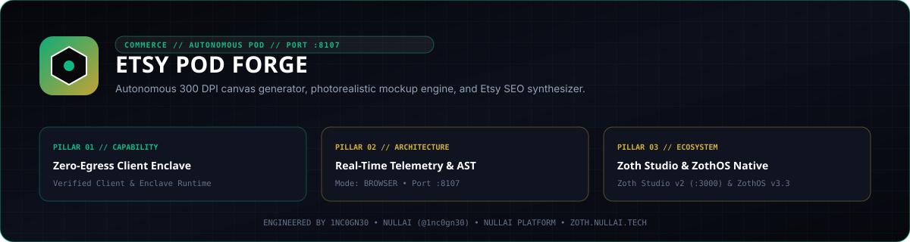

<p align="center">
  
</p>

# Etsy POD Forge

**Python 3.10+ print-on-demand 300 DPI transparent PNG canvas generator, lifestyle product mockup compositor, 13-tag Etsy SEO listing synthesizer, prompt catalog, and loopback HTTP studio.**

- **Zoth Studio v2 Dossier**: [https://zoth.nullai.tech/tools/etsy-pod-forge](https://zoth.nullai.tech/tools/etsy-pod-forge)
- **Default Loopback Endpoint**: `http://127.0.0.1:8107`
- **Runtime Dependencies**: `Pillow>=10.0.0` (all HTTP/CLI/ZIP logic uses Python `stdlib`)
- **License**: MIT (100% free and open-source)

---

## Overview

`etsy-pod-forge` automates asset and listing preparation for print-on-demand storefronts across apparel (`4500x5400 px @ 300 DPI`), ceramic mugs, canvas totes, and wall art cadres:

- **300 DPI Print Canvas Generator**: Renders transparent RGBA PNG print files (`CanvasGenerator`) with custom titles, subtitles, and personalized name arrays.
- **Lifestyle Mockup Compositor**: Composites generated print artwork onto garment, mug, tote, or frame mockups (`MockupEngine`) with configurable colorways.
- **Etsy Listing Kit Synthesizer**: Builds<=140-character titles, 13 search tags (`<=20` chars each, zero duplicates), structured descriptions, and fee/margin breakdowns (`listing_synthesizer.py`) with strict invariant validation.
- **ZIP Asset Bundler & Prompt Catalog**: Packages print PNG, lifestyle JPEG, `listing_details.txt`, and `listing_data.json` into a single downloadable ZIP archive alongside searchable image-generation prompt recipes.

---

## Architecture

```text
src/etsy_pod_forge/
├── canvas_generator.py     # Pillow RGBA 300 DPI print canvas renderer across POD cadres
├── mockup_engine.py        # Lifestyle product mockup compositor and colorway renderer
├── listing_synthesizer.py  # Etsy 140-char title, 13-tag validator & fee/net-margin calculator
├── prompt_vault.py         # Searchable POD design prompt catalog by cadre and keyword
├── server.py               # Multi-threaded loopback HTTP API + web studio (127.0.0.1:8107)
└── cli.py                  # Unified CLI entrypoint (`etsy-pod-forge`)
```

---

## Quickstart

```bash
git clone https://github.com/1nc0gn30/etsy-pod-forge.git
cd etsy-pod-forge
python3 -m pip install -e .

# Launch the loopback web studio on http://127.0.0.1:8107
python3 server.py --host 127.0.0.1 --port 8107
```

Or launch via the CLI entrypoint:

```bash
etsy-pod-forge serve --host 127.0.0.1 --port 8107
```

---

## CLI Usage

```bash
# View CLI help
etsy-pod-forge --help

# Generate a print-ready 300 DPI PNG canvas (or --preview for quick inspection)
etsy-pod-forge generate --cadre apparel --title "Grandma's Garden" --names "Emma,Liam,Olivia" --out apparel_canvas.png

# Composite artwork onto a lifestyle product mockup
etsy-pod-forge mockup --cadre apparel --color sand --out apparel_mockup.jpg

# Synthesize an Etsy SEO listing kit with invariant validation and JSON output
etsy-pod-forge listing --cadre apparel --retail 34.99 --cost 12.50 --json

# Search or filter the prompt recipe catalog
etsy-pod-forge prompts --cadre apparel --limit 5
etsy-pod-forge prompts --search botanical

# Query live server telemetry on port 8107
etsy-pod-forge status --port 8107
```

### ZothOS v3.4.0 CLI Integration

On ZothOS v3.4.0 workstations, `etsy-pod-forge` and `etsy-pod-forge-tui` are installed in `/usr/local/bin/`:

```bash
etsy-pod-forge listing --cadre apparel --json
etsy-pod-forge-tui --json
etsy-pod-forge serve --port 8107
```

---

## HTTP API Reference

When running on `http://127.0.0.1:8107`:

| Method | Endpoint | Description |
| :--- | :--- | :--- |
| `GET` | `/health`, `/api/health` | Service health status, port, version, and uptime |
| `GET` | `/api/stats` | Render, mockup, listing, and export counters |
| `GET` | `/api/cadres` | Supported POD product cadres and print specifications |
| `GET` | `/api/prompts` | Prompt catalog (`?cadre=...` or `?q=...`) |
| `POST` | `/api/generate-canvas` | Render base64 PNG print canvas (`cadre`, `preview`, `title`, `subtitle`, `names`) |
| `POST` | `/api/generate-mockup` | Composite base64 JPEG lifestyle mockup (`cadre`, `color`, `title`, `names`) |
| `POST` | `/api/generate-listing` | Synthesize Etsy title, 13 tags, description, fees, and invariant check |
| `POST` | `/api/export-kit` | Download a `.zip` bundle with print PNG, mockup JPEG, text, and JSON kit |

---

## Testing & Verification

```bash
# Run the pytest suite
PYTHONPATH=src python3 -m pytest -q

# Or run via CLI subcommand
etsy-pod-forge test

# Scan repository with gitleaks
gitleaks detect --source . --no-banner --redact
```

---

## Support

Etsy POD Forge is 100% free and open-source software. Optional community support is available via [Buy Us a Coffee (Stripe)](https://buy.stripe.com/3cIfZg27PdKo2D64Ocfw40X).

## License

MIT License — Copyright (c) 2026 [1nc0gn30](https://1nc0gn30.si) (`@1nc0gn30`) & [NullAI](https://nullai.tech). See [LICENSE](LICENSE) for full text.
